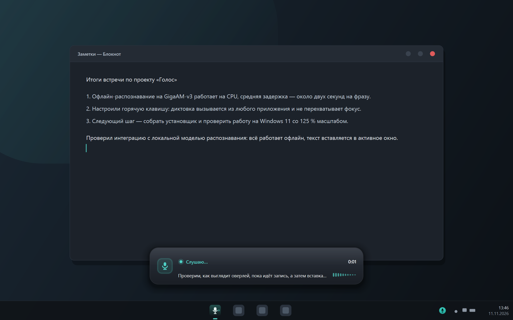
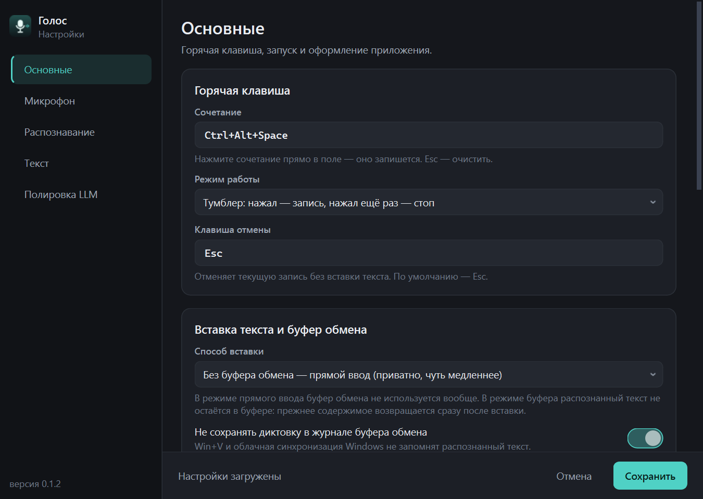
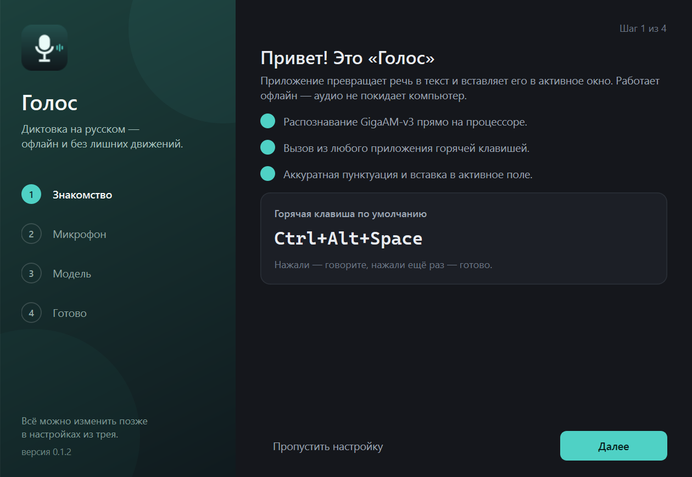
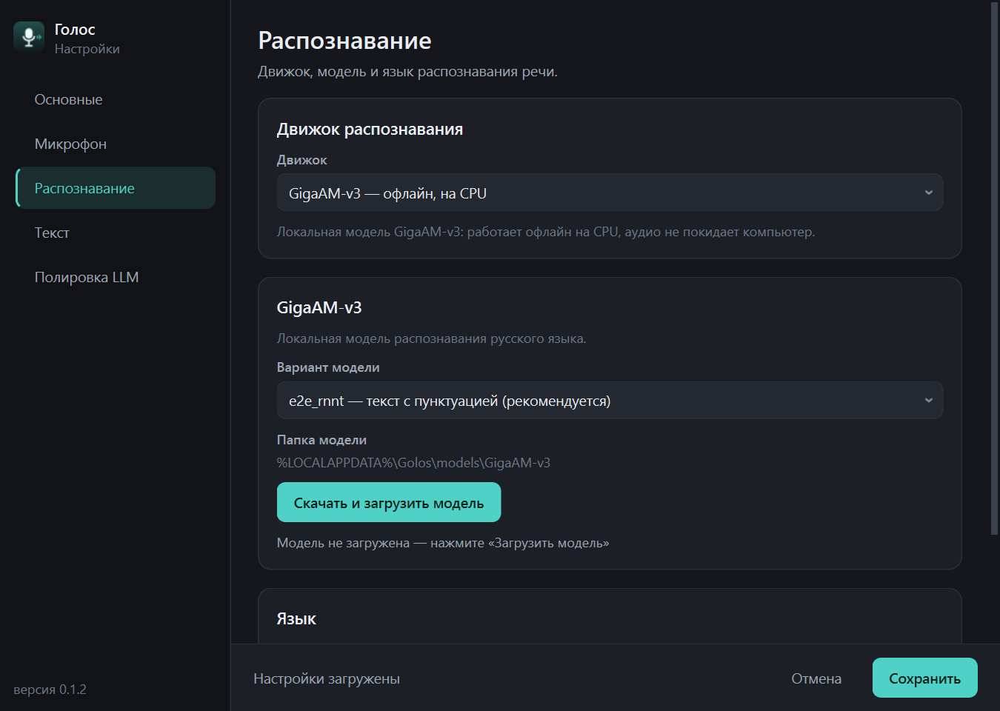
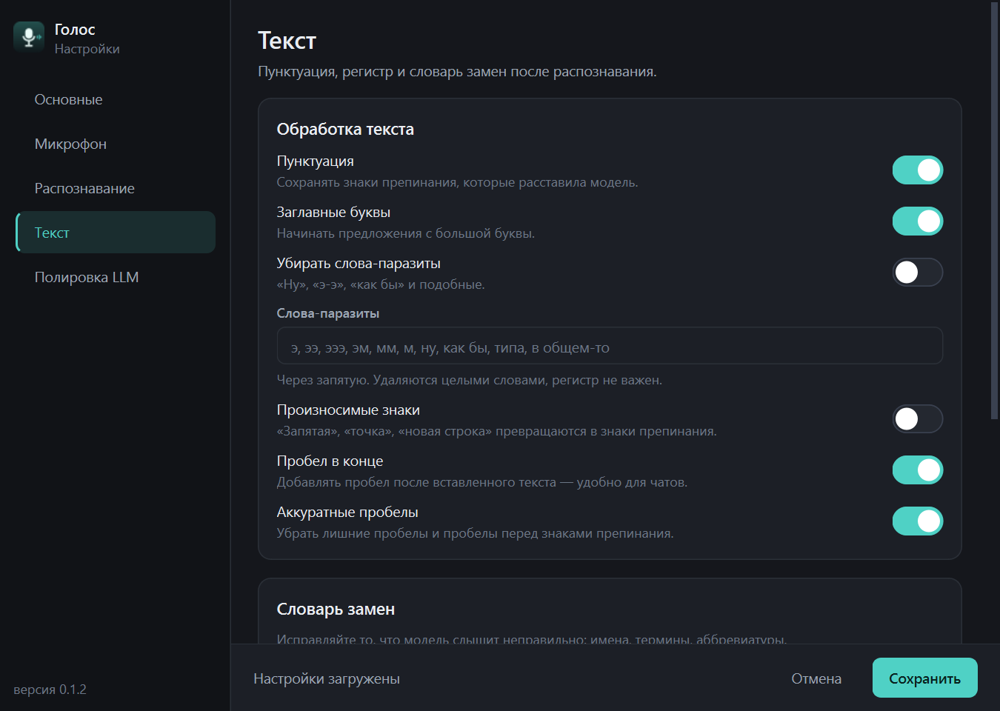
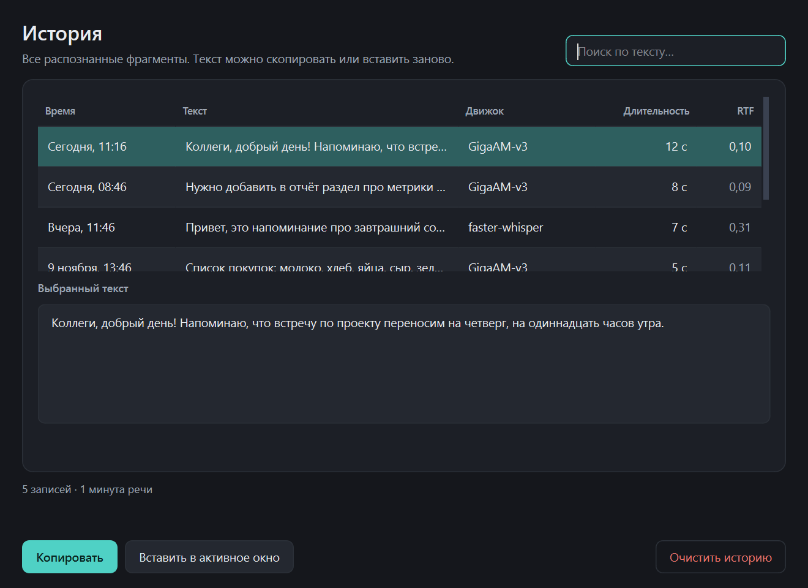

# «Голос» — офлайн-диктовка для Windows на русском

[](https://github.com/ganinnikita1/golos/actions/workflows/ci.yml)
[](https://github.com/ganinnikita1/golos/releases)
[](LICENSE)
[](pyproject.toml)
[](README.md)

**«Голос»** — приложение для Windows, которое превращает речь в текст в любом
приложении: почта, мессенджер, браузер, редактор кода, строка поиска. Нажали
горячую клавишу, сказали фразу — текст появился там, где стоит курсор. Всё
распознавание идёт **локально на CPU**, без интернета и без подписки.

Главное отличие от обычных диктовок: распознавание **русского** языка работает на
модели [GigaAM-v3](https://huggingface.co/ai-sage/GigaAM-v3) (SberDevices, лицензия MIT),
которая по качеству на русской речи опережает Whisper-large-v3 и тем более
мультиязычные модели вроде SenseVoice. Модель обучена на 700 000 часов русской речи
и выдаёт сразу **готовый текст с пунктуацией, заглавными буквами и цифрами** — как
встроенная диктовка в облачных ассистентах, только офлайн.

> **English summary.** Golos is an offline Russian dictation app for Windows. It runs
> GigaAM-v3 (MIT, SberDevices) on CPU, produces punctuated text, and inserts it into
> any focused window — by default without touching the clipboard at all. No cloud,
> no subscription. Benchmarks and docs are in Russian; see [docs/ARCHITECTURE.md](docs/ARCHITECTURE.md).

> **Безопасность:** текущая версия — **0.1.2**. Внутренние сборки 0.1.0/0.1.1 не
> публиковались: в 0.1.0 модель исполнялась без проверки целостности, в 0.1.1 в
> собранном архиве нашёлся служебный файл с путём сборочной машины. В 0.1.2 ревизия
> модели закреплена по commit SHA, SHA256 файлов сверяется до запуска remote-кода,
> а сборка проверяет бандл на утечку путей. Подробности — [SECURITY.md](SECURITY.md).

---

## Содержание

- [Что умеет](#что-умеет)
- [Как это выглядит](#как-это-выглядит)
- [Качество: цифры, а не обещания](#качество-цифры-а-не-обещания)
- [Установка](#установка)
- [Как пользоваться](#как-пользоваться)
- [Буфер обмена и приватность](#буфер-обмена-и-приватность)
- [Где лежат данные](#где-лежат-данные)
- [Архитектура](#архитектура)
- [Разработка и поддержка проекта](#разработка-и-поддержка-проекта)
- [Версии и выпуски](#версии-и-выпуски)
- [Ограничения и частые вопросы](#ограничения-и-частые-вопросы)
- [Лицензии](#лицензии)

---

## Что умеет

| Возможность | Как это работает |
|---|---|
| Диктовка в любое приложение | Глобальная клавиша, вставка без буфера обмена (по умолчанию) или через буфер |
| Буфер обмена остаётся чистым | диктовка никогда не остаётся в буфере: текст либо печатается напрямую, либо после вставки возвращается прежнее содержимое, а сам текст помечается приватным и не попадает в журнал Windows (Win+V) и облачную синхронизацию |
| Два режима клавиши | `toggle` — нажали/нажали; `push_to_talk` — держать и отпустить |
| Готовый текст | Пунктуация, заглавные, нормализация чисел — прямо из модели |
| Словарь замен | «джипити» → «GPT», «докер» → «Docker» — регистронезависимо |
| Произносимые знаки | «запятая», «точка с запятой», «новая строка» — включ. в настройках |
| Удаление слов-паразитов | «э-э», «ну», «как бы» — по списку |
| LLM-полировка (опция) | Любой OpenAI-совместимый сервер (DeepSeek/OpenAI): правит пунктуацию и оговорки. Полностью отключаема |
| Облачный ASR (опция) | OpenAI/Groq/custom endpoint для максимального качества или экзотических языков |
| Трей и оверлей | Мини-индикатор записи с уровнем микрофона не перехватывает фокус |
| История | Последние 200 распознаваний: поиск, копирование, повторная вставка; хранение можно отключить |
| Автозапуск | Галочка в настройках (реестр `HKCU\...\Run`) |

Распознавание **не требует интернета после первой загрузки модели** (≈450 МБ,
скачивается один раз и работает локально). LLM-полировка и облачный ASR — только
если явно включены.

## Как это выглядит

Оверлей во время диктовки (не перехватывает фокус, клики проходят сквозь него):



Окно настроек (тёмная тема, 6 разделов) и мастер первого запуска:

| Настройки → Основные | Мастер первого запуска |
|---|---|
|  |  |

| Распознавание | Текст и словарь | История |
|---|---|---|
|  |  |  |

Больше снимков (все вкладки, светлая тема, меню трея) — в [`docs/screenshots/`](docs/screenshots/).

## Качество: цифры, а не обещания

Замеры на этой машине (AMD Ryzen 7 8845HS, 8 ядер / 16 потоков, **без GPU**),
30 синтезированных русских фраз (Windows SAPI «Irina») + 1 реальная запись,
всего 367 секунд аудио:

| Движок / вариант | WER, % | WER без чисел, % | CER, % | RTF (медиана) | RTF на 13.9 c | Пунктуация | Заглавные |
|---|---:|---:|---:|---:|---:|---:|---:|
| **GigaAM-v3 / e2e_rnnt** (по умолчанию) | 4.4 | **1.6** | 3.1 | **0.066** | 0.062 | 97% | 97% |
| GigaAM-v3 / e2e_ctc | 4.9 | 2.1 | 3.6 | 0.051 | 0.042 | 100% | 97% |
| faster-whisper large-v3-turbo (int8, CPU) | 4.1 | 1.3 | 3.1 | 0.925 | 0.485 | 42% | 97% |
| GigaAM-v3 / rnnt (без пунктуации) | 0.5\* | 0.5 | 0.1 | 0.070 | 0.058 | 0% | 0% |

\* Сырые варианты не ставят знаков, не делают заглавных и пишут числа словами —
их WER выглядит ниже, но для диктовки они дают текст, который нужно дописывать руками.

**Скорость.** RTF 0.062 означает, что 14-секундная фраза распознаётся за **0.85 секунды**.
Полный цикл «отпустил клавишу → текст вставлен» на фразах 5–15 секунд — примерно
**0.7–1.4 секунды** (включая ~0.6 с на вставку с восстановлением буфера). Загрузка
модели при старте — 3–6 секунд, происходит в фоне, пока приложение уже висит в трее.

Полный отчёт с разбивкой по категориям фраз и примерами: [`reports/asr_bench.md`](reports/asr_bench.md),
архитектура ASR-слоя — [`reports/asr_implementation.md`](reports/asr_implementation.md).

### Почему это не хуже облачной диктовки

* GigaAM-v3 в карточке модели обгоняет Whisper-large-v3 на русских доменах:
  средний WER 8.4% против 25.1%, на «естественной речи» — 6.9% против 13.6%.
  На нашем наборе WER 1.6% без учёта нормализации чисел.
* e2e-ревизия обучена сразу с пунктуацией и нормализацией текста — не нужен
  отдельный пунктуатор, который часто «додумывает» лишнее.
* Если хочется ещё лучше на специфичном домене — включите словарь замен и
  LLM-полировку: они доводят текст до «редакторского» вида.

## Установка

### Вариант 1. Готовый установщик (рекомендуется)

```powershell
# 1. Собрать (нужен только при первом запуске; ~10 минут, ~750 МБ на диске)
powershell -ExecutionPolicy Bypass -File packaging\build.ps1

# 2. Установить в профиль пользователя (без прав администратора)
powershell -ExecutionPolicy Bypass -File packaging\install.ps1 -DesktopShortcut

# автозапуск при входе в Windows:
powershell -ExecutionPolicy Bypass -File packaging\install.ps1 -Autostart
```

Ярлык «Голос» появится в меню «Пуск» (и на рабочем столе). Удаление:
`packaging\install.ps1 -Uninstall` (данные в `%APPDATA%\Golos` сохраняются).

### Вариант 2. Из исходников (для разработки)

```powershell
git clone https://github.com/ganinnikita1/golos.git
cd golos
python -m venv .venv
python tools\bootstrap_env.py       # CPU-сборка torch + все зависимости
.\run.ps1                           # запуск (или Голос.cmd двойным кликом)
.\run.ps1 -Log                      # с консолью и живыми логами
.\run.ps1 -Cli selftest             # самодиагностика окружения
```

При первом запуске приложение предложит мастер настройки: выбрать микрофон,
проверить его и скачать модель (≈450 МБ, один раз).

## Как пользоваться

1. Запустите «Голос» — появится иконка в трее, модель догрузится в фоне
   (уведомление «Модель распознавания готова»).
2. Поставьте курсор в любое приложение (письмо, чат, редактор).
3. Нажмите **Ctrl+Alt+Space** — появится оверлей «Слушаю…», говорите.
4. Нажмите ещё раз (или отпустите в режиме push-to-talk) — через секунду текст
   вставится в активное окно (без использования буфера обмена).
5. **Esc** во время записи — отмена.

Горячую клавишу и режим можно поменять в настройках (трей → «Настройки» →
«Основные»). Если сочетание занято другим приложением, выберите другое: подойдёт
любое из `Ctrl+Alt+<буква>`, `F9`, «правая Alt» и т.п.

### Настройки (трей → «Настройки»)

* **Основные** — клавиша, вставка без буфера/через буфер, автозапуск, звуки, оверлей, тема.
* **Микрофон** — устройство ввода и кнопка «Проверить микрофон» (записывает 3 с и
  показывает уровень).
* **Распознавание** — движок (GigaAM-v3 / faster-whisper / облако), вариант модели,
  статус загрузки, ключ облачного API.
* **Текст** — пунктуация, заглавные, слова-паразиты, произносимые знаки, словарь замен.
* **Полировка LLM** — включение и параметры OpenAI-совместимого сервера.
* **О программе** — версия, папки конфига и логов.

## Буфер обмена и приватность

По умолчанию диктовка вставляется **прямым вводом** (Unicode через `SendInput`):
буфер обмена не используется вообще, поэтому распознанный текст физически не может
в него попасть. Это чуть медленнее пасты, зато ничего не оставляет после себя.

Если нужен максимально совместимый способ (сложные редакторы, некоторые
Electron/Java-приложения), в настройках → «Вставка текста и буфер обмена» можно
включить режим **через буфер**. В этом режиме приложение:

1. запоминает текущее содержимое буфера (все форматы, включая картинки и файлы);
2. кладёт распознанный текст и вставляет его по `Ctrl+V`;
3. **возвращает прежнее содержимое** через ~0,5 с. В это короткое окно текст
   физически лежит в глобальном буфере — сторонний менеджер буфера теоретически
   может успеть его прочитать; если это критично, используйте режим прямого ввода;
4. помечает текст служебными форматами Windows `CanIncludeInClipboardHistory=0`,
   `CanUploadToCloudClipboard=0`, `ExcludeClipboardContentFromMonitorProcessing`,
   поэтому он **не сохраняется в журнале Win+V и не уходит в облако**;
5. если вернуть прежнее содержимое не удалось (буфер занят другим приложением) —
   буфер очищается, чтобы диктовка в нём не осталась.

Дополнительно в настройках есть переключатели «Не сохранять диктовку в журнале
буфера обмена» и «Возвращать прежнее содержимое буфера».

Если в журнале Win+V остались старые записи от тестов/экспериментов, их можно
убрать вручную: `Win+V` → «…» → «Очистить всё» (или Параметры → Система → Буфер обмена).

## Безопасность и целостность

* Аудио и распознанный текст **не покидают компьютер** при настройках по умолчанию;
  облачный ASR и LLM-полировка выключены, пока их не включат явно.
* Приложение **не пишет распознанный текст в логи**, а API-ключи читает только из
  переменных окружения (в коде и логах их нет).
* **Модель проверяется по хешам.** GigaAM-v3 — это веса *и* код
  (`modeling_gigaam.py`), который исполняется локально. Чтобы подмена модели на
  Hugging Face не привела к выполнению чужого кода, ревизия фиксируется на
  неизменяемом commit SHA, а SHA256 всех файлов сверяется с манифестом
  [`golos/asr/model_manifest.json`](golos/asr/model_manifest.json) **до** импорта
  remote-кода. При несовпадении модель не загружается.
* Пути в интерфейсе и диагностике показываются как `%APPDATA%`/`%LOCALAPPDATA%` —
  имя учётной записи не попадает на скриншоты и в отчёты, которые вы публикуете.
* CI: действия закреплены по SHA, `GITHUB_TOKEN` read-only, Dependabot следит за
  обновлениями. Подробнее — [SECURITY.md](SECURITY.md).

Проверить целостность модели:

```powershell
.\.venv\Scripts\python.exe -c "from golos.config import default_config; from golos.asr.registry import create_engine; e = create_engine(default_config().asr); e.load(); print('ok')"
# в логе будет: «Целостность GigaAM-v3 подтверждена (commit …)»
```

Перегенерировать манифест (при смене модели): `tools\gen_model_manifest.py`.

## Где лежат данные

| Что | Где |
|---|---|
| Настройки | `%APPDATA%\Golos\config.json` |
| История | `%APPDATA%\Golos\history.jsonl` |
| Логи | `%APPDATA%\Golos\logs\golos.log` |
| Модель | `%LOCALAPPDATA%\Golos\models\GigaAM-v3` |
| Модели faster-whisper | `%LOCALAPPDATA%\Golos\models` (скачиваются при выборе движка) |

Если `%APPDATA%` недоступен на запись, приложение автоматически переходит на
`%USERPROFILE%\Golos`, затем на папку `_data` рядом с exe. Портативный режим:
задайте `GOLOS_APPDATA` и `GOLOS_LOCALAPPDATA`.

## Архитектура

```
микрофон ──► Recorder (sounddevice/PortAudio, 16 кГц mono)
              │  уровни сигнала + VAD-обрезка тишины
              ▼
         DictationPipeline (worker-поток)
              │  1. GigaAM-v3 e2e_rnnt  ──►  текст с пунктуацией
              │  2. postprocess         ──►  словарь, регистр, пробелы
              │  3. LLMPolisher (опц.)  ──►  аккуратная правка
              │  4. Injector            ──►  прямой ввод или буфер + Ctrl+V
              ▼
         EventBus ──► UI (трей, оверлей, настройки, история)
```

* **Потоки.** Qt-UI в главном потоке; распознавание — в отдельном worker-потоке;
  глобальный хук клавиатуры — свой поток с message loop; аудио — колбэк PortAudio.
  Общение через потокобезопасную шину событий, UI забирает её из `QTimer`.
* **Вставка.** По умолчанию — прямой Unicode-ввод (`SendInput`), буфер обмена не
  трогается. Альтернативный режим — буфер обмена: сохраняем содержимое, кладём текст,
  отправляем `Ctrl+V`, возвращаем буфер и помечаем текст приватным (без Win+V и облака).
* **Модель.** Веса GigaAM-v3 (Conformer, 240M параметров) грузятся на CPU в
  `torch.inference_mode()`, число потоков = физические ядра. Длинные записи
  режутся на чанки 20 с с перекрытием и склеиваются без дублей.
* **Никаких внешних утилит.** ffmpeg не нужен: аудио с микрофона приходит сразу
  как PCM. Звуковые сигналы синтезируются на месте.

Подробности: [docs/ARCHITECTURE.md](docs/ARCHITECTURE.md).

### Структура репозитория

```
golos/
  app.py            жизненный цикл, трей/UI, хоткей, потоки, Controller
  pipeline.py       оркестрация: аудио → ASR → текст → полировка → вставка
  config.py         настройки (dataclass + JSON, атомарная запись)
  audio/            запись микрофона, VAD, уровни, звуки
  asr/              GigaAM-v3, faster-whisper, облачный движок
  text/             постобработка, словарь, LLM-полировка
  inject/           вставка текста (прямой ввод, буфер, приватность)
  hotkey/           глобальный хук WH_KEYBOARD_LL
  ui/               трей, оверлей, настройки, история, мастер, тема
tests/              pytest: конфиг, аудио, пайплайн, ASR, текст, вставка, хоткей, e2e
packaging/          PyInstaller-спецификация, сборка, установка
tools/              bootstrap зависимостей, бенчмарк, загрузка модели
docs/               архитектура, разработка, скриншоты
reports/            отчёты бенчмарка ASR
```

## Разработка и поддержка проекта

* [CONTRIBUTING.md](CONTRIBUTING.md) — как предложить улучшение, стиль кода, требования к PR.
* [docs/DEVELOPMENT.md](docs/DEVELOPMENT.md) — окружение, тесты, сборка, отладка.
* [docs/ARCHITECTURE.md](docs/ARCHITECTURE.md) — архитектура и контракты модулей.
* [docs/RELEASE-verification.md](docs/RELEASE-verification.md) — как скачать и проверить релиз.
* [SECURITY.md](SECURITY.md) — приватность и как сообщить об уязвимости.
* [CHANGELOG.md](CHANGELOG.md) — история изменений.

```powershell
cd golos
.\.venv\Scripts\python.exe -m pytest tests -q            # быстрые тесты (без модели)
.\.venv\Scripts\python.exe -m pytest tests -m slow       # тесты с реальной моделью/GUI
.\.venv\Scripts\python.exe -m golos.cli selftest         # самодиагностика
git pull && powershell -File packaging\build.ps1         # обновить собранное приложение
```

CI (GitHub Actions) на каждый push/PR прогоняет быстрые тесты на Windows:
`.github/workflows/ci.yml`.

## Версии и выпуски

Проект следует [Semantic Versioning](https://semver.org/lang/ru/):

* `v0.1.x` — текущая ветка разработки (первый публичный выпуск);
* изменения фиксируются в [CHANGELOG.md](CHANGELOG.md) в формате
  [Keep a Changelog](https://keepachangelog.com/ru/1.1.0/);
* каждый выпуск — тег `vX.Y.Z` и страница [Releases](https://github.com/ganinnikita1/golos/releases)
  с описанием изменений и файлом `SHA256SUMS` для проверки архива исходников;
* совместимость настроек: `config.json` версионируется полем `version`, миграции —
  в `golos/config.py`.

Чтобы обновиться до новой версии: `git pull`, затем `packaging\build.ps1` и
`packaging\install.ps1` (или запуск из исходников через `run.ps1`).

## Ограничения и частые вопросы

* **Приложения, запущенные от администратора.** Windows не даёт вставлять текст в
  окна с более высокими правами, чем у «Голоса». Если диктуете в elevated-приложение —
  запустите «Голос» от администратора.
* **Другие раскладки/языки.** По умолчанию русский. Для английского/смешанной речи
  переключите движок на faster-whisper или облачный ASR в настройках.
* **Микрофон не найден.** Проверьте «Настройки → Микрофон»; если устройства не
  видно, закройте приложения, монопольно занявшие микрофон (Zoom/Teams/Discord),
  и нажмите «Обновить».
* **Модель долго грузится в первый раз.** Она скачивается один раз; дальше загрузка
  из локального кэша — 3–6 секунд в фоне при старте.
* **Прямой ввод не сработал в конкретном приложении.** Переключите способ вставки на
  «Через буфер обмена» — приватность там тоже обеспечена.
* **Антивирус.** PyInstaller-сборки иногда ложно срабатывают; добавьте папку
  установки в исключения.
* **Данные.** Всё локально. LLM-полировка отправляет только текст распознанной фразы
  на указанный вами сервер (по умолчанию выключена).

## Лицензии

Код — MIT (см. [LICENSE](LICENSE)). Модель GigaAM-v3 — MIT (© SberDevices).
PySide6 — LGPL-3.0, PyTorch — BSD-3-Clause.
